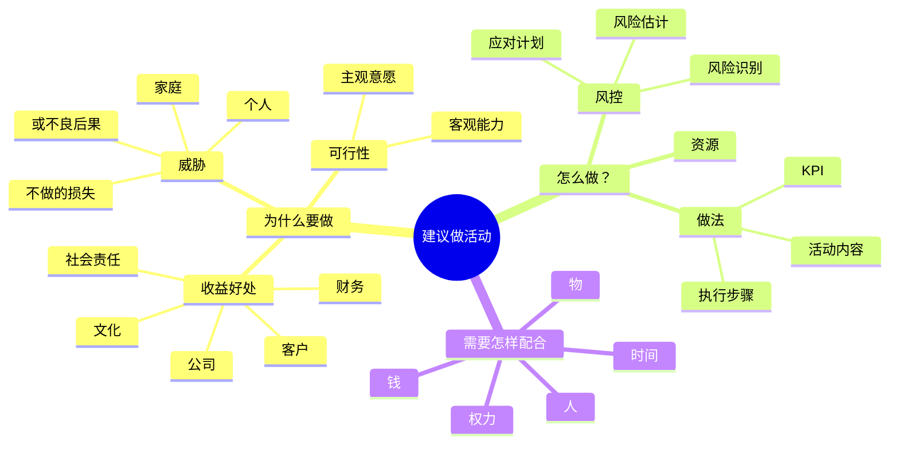

# 活动方案

**本质**：写的是活动安排，呈现的是收益判断和责任边界。
**基调**：有依据、算得清——先说为什么值得做，再说怎么做。

**提问清单**

- 活动目的是什么？
- 预期收益是什么？（公司、客户、财务、文化、社会责任等多维度）
- 不做会有什么损失？
- 具体怎么做？（活动内容、执行步骤、KPI）
- 需要什么资源？（人、钱、物、时间、权力）

**数据框架**

| 要什么 | 口径要求 | 常见锚点 |
|---|---|---|
| 预期收益 | 维度（公司 / 客户 / 财务 / 文化）+ 口径 | 历史同类活动数据 |
| 不做的损失 | 影响面与时间 | 台账、历史记录 |
| 资源需求 | 人、钱、物、时间 | 预算表、排期 |
| 风险项 | 发生概率与影响面 | 历史事故记录 |

**金字塔结构**

**写作要点**

- 阐述为什么要做（收益、威胁、可行性）
- 说明怎么做（做法、风控、KPI）
- 明确需要怎样配合（人、钱、物、时间、权力），把责任边界写清楚
