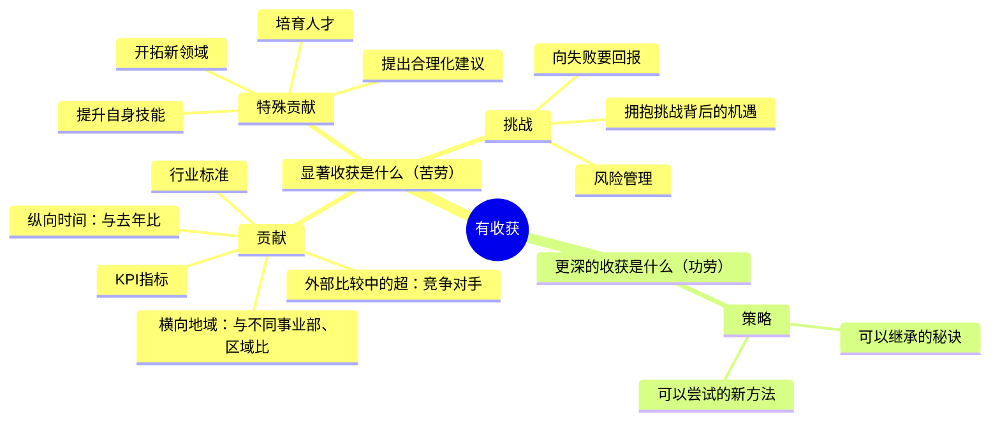

# 年终总结

**本质**：写的是成绩，呈现的是潜力。
**基调（年终总结）**：有深度——不是流水账，是行动指南。
**基调（述职、评审、竞聘）**：依据与证据——每个判断都要能追溯到具体事实。

**提问清单**

- 这份总结用于年度考核，还是评审 / 竞聘场合？（决定用哪条基调）
- 今年完成了哪些关键工作？请用数字说明。
- 有哪些特殊贡献或突破？（提出合理化建议、培育人才、提升自身技能、开拓新领域）
- 遇到了什么挑战？如何克服的？
- 有什么可以沉淀成方法、明年能继承的经验？
- 明年的工作方向或目标是什么？

**数据框架**（清单式收集用；最后一列是这类数据常见的锚点）

| 要什么 | 口径要求 | 常见锚点 |
|---|---|---|
| 主贡献指标的实际值 | 时间范围 + 对比基准（去年 / 目标 / 同行） | 业务报表、系统后台 |
| 3 项以内的关键工作，每项一个结果 | 谁、什么时候、结果 | 项目记录、排期表 |
| 特殊贡献（合理化建议、带人、新技能、新领域） | 覆盖面、受益对象 | 培训记录、评审记录 |
| 一次挑战或失误 + 处理动作 | 影响范围、已做的补救 | 复盘记录、台账 |

**金字塔结构**

**写作要点**

- 塔尖不是回顾，而是行动指南
- 将工作成果写出意义：提供一线经验、不同视角
- 在罗列贡献后，找出问题或机遇，以及解决方案
- 每个数字都要有对比基准（去年、目标、同行、其他区域，或同一流程改造前后的对比），孤立的数字没有分量

**成品示例**（数据均为虚构，只示范结构与语言，不要当作事实引用）

**《2025 年度总结：把"选品靠感觉"做成一套可复用的方法》**

- **S（情境）**：我的团队负责三个类目，今年承担部门一半的增量目标。
- **C（冲突）**：复盘时发现，上半年两个爆款其实是撞上的：下半年按同样方法推了 5 款新品，只有 1 款起量，起量率 20%。
- **Q（问题）**：明年的增长，能不能不再靠运气？
- **A（回答）**：我把今年的经验沉淀成 12 条选品判断清单，Q4 用它推的 3 款新品有 2 款起量，起量率提到 60%。我建议明年把它变成团队标准流程。

**一、贡献：三个类目完成 GMV 1,860 万，同比增长 41%**（去年 1,320 万，部门平均增速 22%）

- 类目 A：480 万 → 810 万，增量主要来自 3 个新品
- 类目 B：620 万 → 780 万，靠老客复购率从 18% 提到 26%
- 类目 C：220 万 → 270 万，受平台流量政策影响，增速低于部门平均

**二、特殊贡献：把选品经验做成 12 条判断清单**

- Q4 用清单推 3 款新品，2 款起量，起量率从 20% 提到 60%
- 带 2 名新人独立负责类目 C，其中 1 人已能独立完成月度选品评审
- 清单第 7 条"退货率高于类目均值 3 个百分点的爆款要重新核算利润"来自今年的一次失误

**三、教训：夏季品备货失误压了 47 万库存**

- 当时的判断依据是好评率 96%，没有看退货率 21%（类目均值 12%）——按当时的指标看，这个判断是合理的，只是漏了这一层
- 8 月清仓，10 月回笼 38 万，亏损 9 万
- 退货率已写进清单第 7 条，成为新品上架前的必检项

**四、明年方向：把清单变成团队流程**

- 一季度用清单跑满 10 个新品，把起量率稳定在 50% 以上
- 给类目 B、C 也搭退货率看板，让货品风险提前 2 周可见

**结尾**：明年一季度我会把这套清单跑满 10 个新品，每个月把起量率同步给你。如果效果稳定，希望你能帮我把清单推给另外两个小组——他们的类目结构和我们接近，应该能直接复用。

**结构说明**

- 塔尖是"把选品方法沉淀下来并推广"，不是"今年做了多少事"——总结类的价值在潜力，不在账本。
- 第二层按"贡献 → 特殊贡献 → 教训 → 明年方向"分组：前三项回答"今年值不值"，第四项回答"明年怎么走"。
- 冲突类型选"追求理想"：现状（靠运气）与理想（可复制的方法）之间有明确差距，冲突由复盘数据自然带出。

**待补信息清单**

- 【待补：类目 C 增速偏低的具体原因】——正文一里只写了"受平台流量政策影响"，读者会追问是政策变化还是内部投放节奏问题。
- 【待补：推广清单可能遇到的阻力】——结尾建议推广给其他小组，但没说阻力，领导很可能问到。

**优化建议**

- 语言质感：类目 B 的"复购率从 18% 提到 26%"可以再往前挖一步原因，写成"说明老客的购买动作已经从促销驱动转为常规补货"。
- 语言温度：教训部分的"备货失误"保留了"当时的判断是合理的"，避免整段变成自我检讨。
