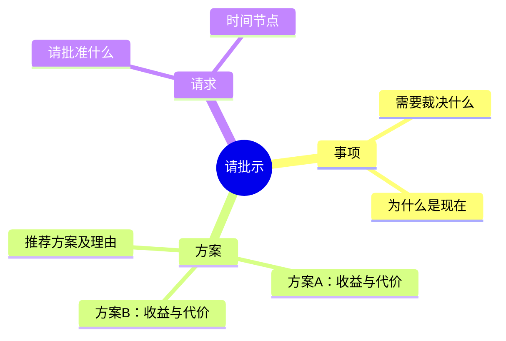

# 请示

**本质**：内容是提问，呈现的是主动思考方式。
**基调**：有主见——给清晰的量化标准让领导裁决，不要把问题原样上交。

**提问清单**（叙事型，按 `SKILL.md` 的通用四题逐轮问）

- 需要领导裁决的事项是什么？
- 有哪些可选方案？各自的收益和代价是什么？
- 你推荐哪个方案？为什么？
- 决策的时间节点是什么？过期会有什么影响？
- 希望领导具体做什么？（批准、签字、协调资源）

**金字塔结构**

**写作要点**

- 塔尖是明确的请求，不是背景铺垫
- 给方案不给问答题，每个方案都写清代价
- 请求要具体到动作和时间（"请批准 4 月 1 日起执行 X"）
- 批复类回复态度明确，不用"似属可行""酌情办理"
