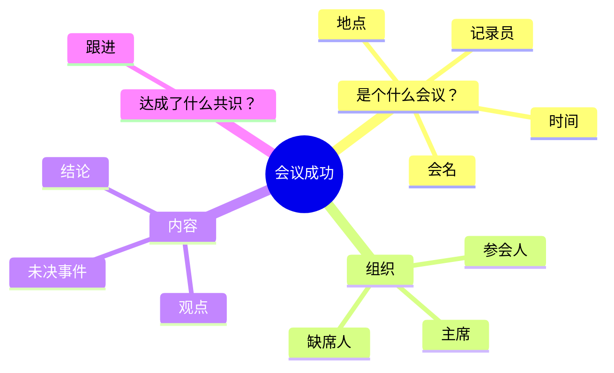

# 会议记录

**本质**：写的是会议经过，呈现的是可执行、可追溯。
**基调**：客观、可跟进——只记结论和未决事项，不做美化。

**提问清单**（叙事型，按 `SKILL.md` 的通用四题逐轮问）

- 会议名称、时间、地点、记录人分别是什么？
- 参会人、缺席人、主持人是哪些？
- 达成了哪些结论？有哪些不同观点需要保留？
- 哪些事项未决？谁在什么时间前跟进什么？

**金字塔结构**

**写作要点**

- 清晰记录会议基本信息
- 明确达成的共识和结论
- 记录未决事件和后续跟进事项
- 跟进事项必须落到"谁、做什么、什么时候前"，否则会议记录等于没写
