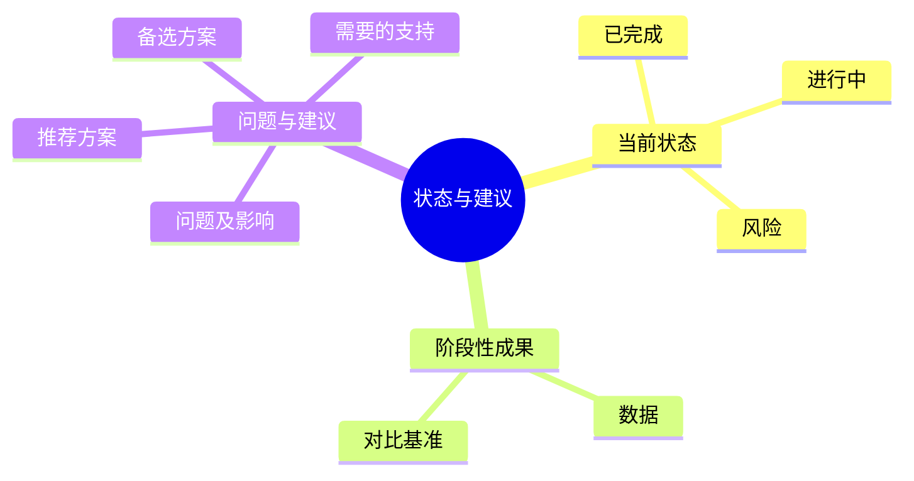

# 进展汇报

**本质**：写的是阶段性进展，呈现的是把事情推进到底的能力。
**基调**：不讨教——给方案，不只提问题；让领导做选择题，不做问答题。

**提问清单**

- 项目/工作的当前状态是什么？（已完成、进行中、未开始）
- 取得了哪些阶段性成果？请给具体数据。
- 遇到了什么问题？影响范围有多大？
- 你建议的解决方案是什么？需要什么支持？

**数据框架**

| 要什么 | 口径要求 | 常见锚点 |
|---|---|---|
| 已完成事项及起止时间 | 时间窗、负责范围 | 排期表、工单系统 |
| 阶段性成果 | 指标 + 对比基准 + 截止时间 | 业务报表 |
| 问题及影响范围 | 影响面（人数 / 金额 / 时长） | 台账、工单 |
| 方案与所需支持 | 需要的资源、时间点 | 预算表 |

**金字塔结构**

**写作要点**

- 塔尖是结论或建议，不是过程
- 问题必须跟方案，且给出推荐项（"我建议 A，备选 B"）
- 数据写清对比基准和截止时间
