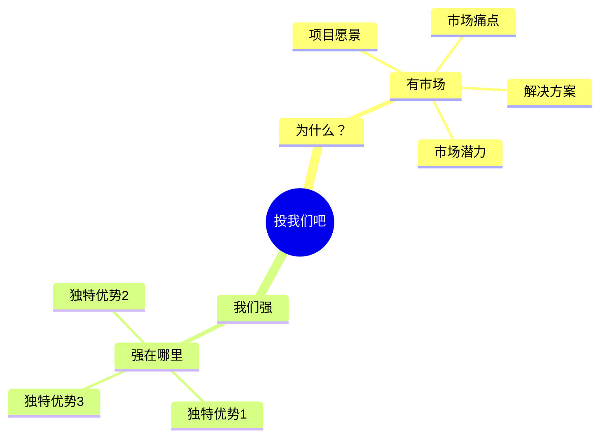

# 项目计划书

**本质**：写的是这件事值得投，呈现的是对市场和自身的判断力。
**基调**：可交付、有证据——判断要落到数据，优势要落到可验证的事实。

**提问清单**

- 项目愿景是什么？（一句话高度精炼）
- 市场痛点是什么？
- 你们的解决方案是什么？
- 市场潜力如何？（规模、用户画像、竞品分析）
- 你们的独特优势是什么？（行业经验、核心技术、团队）
- 发展规划和盈利模式是什么？
- 需要多少融资或资源？

**金字塔结构**

**写作要点**

- 按投资人逻辑组织内容：先讲行业和市场，再讲自己
- 融资额度放最后——先讲价值，再讲价格
- 详细的内容排序见 `references/business-plan.md`，两张卡片共用同一套排序和数据框架
