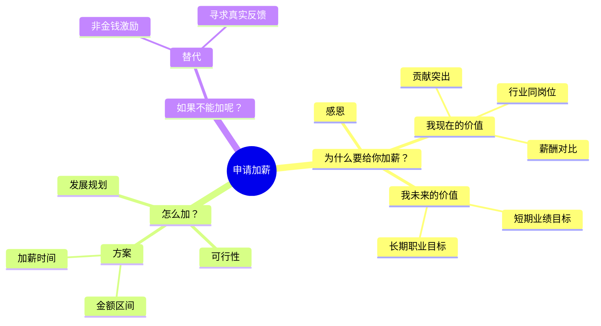

# 加薪申请

**本质**：内容是提问，呈现的是主动思考方式。
**基调**：有主见、有依据——用数字说清"我值多少"，并给出可执行的方案。

**提问清单**

- 你目前的薪资是多少？期望的薪资区间是多少？
- 你的核心贡献有哪些？请用数字说明，最好带对比基准。
- 与同岗位市场薪资相比如何？数据从哪里来？
- 你未来的短期业绩目标、长期职业目标是什么？
- 如果这次不能加，你希望得到什么替代方案？

**数据框架**

| 要什么 | 口径要求 | 常见锚点 |
|---|---|---|
| 核心贡献的实际值 | 时间范围 + 对比基准（去年 / 目标 / 同岗位） | 签约、交付报表 |
| 第二类证据（交付、续约、带人） | 数量 + 质量指标 | 项目记录、客户反馈 |
| 市场薪资区间 | 来源 + 时间 + 岗位口径 | 招聘平台、同行了解、内部薪酬带宽 |
| 未来目标 | 时间点 + 可衡量的口径 | — |

**金字塔结构**

**写作要点**

- 感恩不单独成段：放在正文第一段的第一句，然后立刻进入价值
- 用数字证明贡献（信息化语言），并写清数据来源
- 提出合理的加薪方案（金额区间、时间节点）
- 准备替代方案（非金钱激励、明确下次评估标准）；"不能加怎么办"这一节即使信息不全也要保留，缺的用占位——省略会被读成没有退路

**成品示例**（数据均为虚构，只示范结构与语言）

**《加薪申请：我希望能承担更完整的业务责任，并把薪资调整到匹配的水平》**

- **A（回答）**：我申请把月薪从 18K 调整到 22K，从 4 月 1 日起生效。
- **S（情境）**：我入职 2 年，负责的华东区 3 个客户从 0 起步，去年签约 620 万，占部门新签的 28%。
- **C（冲突）**：今年我的职责已经扩到方案设计和交付管理，相当于团队里 P6 的范围，但薪资仍在 P5 区间；同岗位市场区间是 20-24K。
- 用 ASC 排序：领导时间紧、对这类话题关注度高，先给结论，再补情境和冲突。

**一、我现在的价值：两个可核对的数字**

- 签约：华东区 3 个客户，去年签约 620 万（部门新签 2,210 万，占 28%）
- 交付：今年独立交付 5 个项目，其中 2 个提前 2 周完成，客户续约率 100%
- 带人：协助培养 1 名新同事，已能独立负责 1 个中型客户

**二、我未来的价值：从"做单子"到"做能力"**

- 短期（今年内）：把华东区的交付模板整理成可复用的方法，让新人上手周期从 3 个月缩到 6 周
- 长期：独立带一条业务线，承担从售前到交付的完整责任

**三、我建议的方案**

- 金额：月薪 18K → 22K（涨幅 22%），处在市场区间 20-24K 的中位
- 时间：4 月 1 日起生效，与季度调薪窗口一致
- 依据：市场数据来自【待补：数据来源】

**四、如果这次不能调整**

- 希望能明确达到什么标准、什么时间点可以再谈（例如 Q3 复盘时）
- 也愿意讨论非金钱方案，比如带业务线的正式授权或培训机会

**结尾**：无论结论如何，我都会在 Q2 内把华东区的交付模板整理完并同步给团队。如果您希望先看模板再谈调整，我可以在 3 月底前把第一版发您。

**结构说明**

- 塔尖是"申请把薪资调整到 22K"，不是"我今年很努力"——申请类的价值在于把判断标准摆清楚。
- 第二层按"现在值多少 → 未来值多少 → 怎么加 → 不能加怎么办"分组：前两项给依据，后两项给可执行的方案和退路。
- 用 ASC 排序，因为这是高关注度、领导时间紧的话题，先给要裁决的那一句话。

**待补信息清单**

- 【待补：市场薪资数据来源】——正文三引用了 20-24K 的区间，读者一定会问依据（招聘平台、同行了解还是内部薪酬带宽）。来源说不清，整个方案的支点就没了。

**优化建议**

- 语言质感：第二部分"让新人上手周期从 3 个月缩到 6 周"可以补一句怎么做到（"把交付动作拆成 12 个可检查的节点"），否则听起来像口号。
- 语言温度：结尾先给承诺再给请求，避免"如果不加薪我就……"这类隐含对抗的写法。
