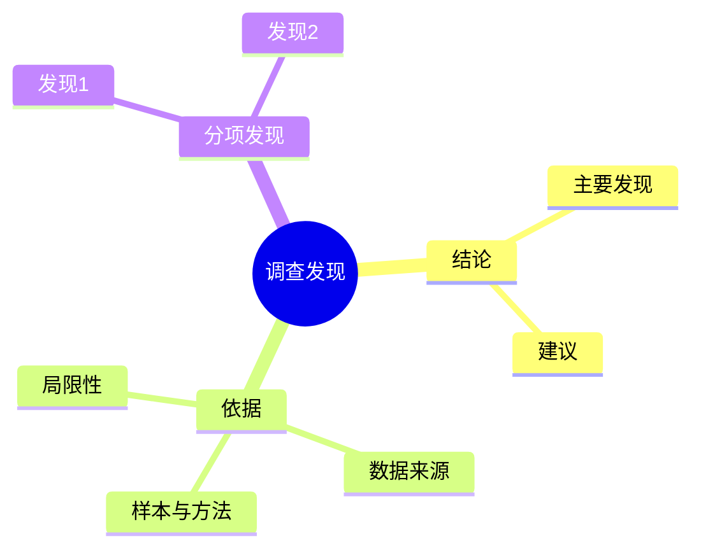

# 调查报告

**本质**：写的是调查结果，呈现的是求实态度。
**基调**：实事求是——用"资料显示""数据显示"，不用"我认为""我觉得"。

**提问清单**

- 这次调查要回答的核心问题是什么？
- 调查的范围和样本是什么？（时间、对象、数量）
- 有哪些关键发现？各自的数据支撑是什么？
- 这些发现指向什么结论或建议？

**数据框架**

| 要什么 | 口径要求 | 常见锚点 |
|---|---|---|
| 调查范围与样本 | 时间、对象、数量 | 抽样记录、问卷后台 |
| 关键发现的数据支撑 | 指标 + 口径 + 时间 | 数据导出、访谈记录 |
| 分项数据 | 分组维度（时间 / 区域 / 人群） | 同上 |
| 局限性 | 样本偏差、未覆盖范围 | — |

**金字塔结构**

**写作要点**

- 结论先行，依据在后；不按调查的时间顺序记流水账
- 数据必须可回溯：来源、口径、时间
- 主动写明局限性，比藏起来更能建立信任
- 描述用"资料显示"，把判断权留给读者
