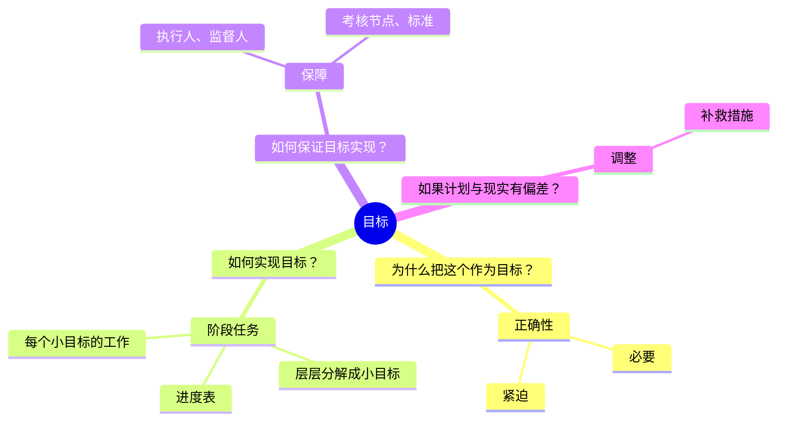

# 工作计划

**本质**：写的是阶段任务，呈现的是责任感。
**基调**：可交付——写结果，不只写行为。

**提问清单**

- 目标是什么？为什么选这个目标（必要性、紧迫性）？
- 如何实现？阶段任务如何层层分解成小目标？进度表怎么排？
- 如何保证目标实现？执行人、监督人、考核节点和标准是什么？
- 如果计划与现实出现偏差，如何调整？

**数据框架**

| 要什么 | 口径要求 | 常见锚点 |
|---|---|---|
| 目标值 | 现状值 + 目标值 + 时间点 | 业务报表、台账 |
| 阶段任务与进度 | 每阶段的起止时间、负责人 | 排期表 |
| 考核节点与标准 | 考核时点、判定标准 | 现有考核制度 |
| 资源需求 | 人、钱、物、时间 | 预算表 |

**金字塔结构**

**写作要点**

- 明确目标的正确性和紧迫性
- 将大目标层层分解为小目标
- 设定保障措施和考核标准
- 预留调整空间，写清偏差出现时的补救办法
