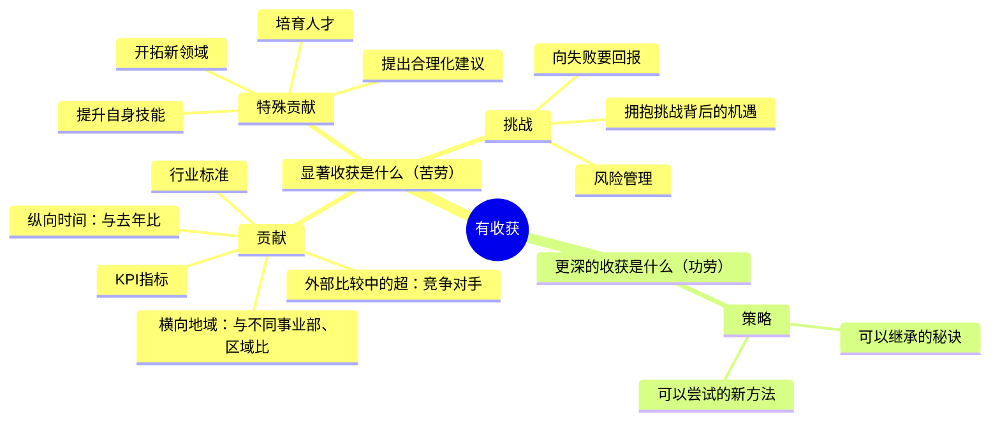
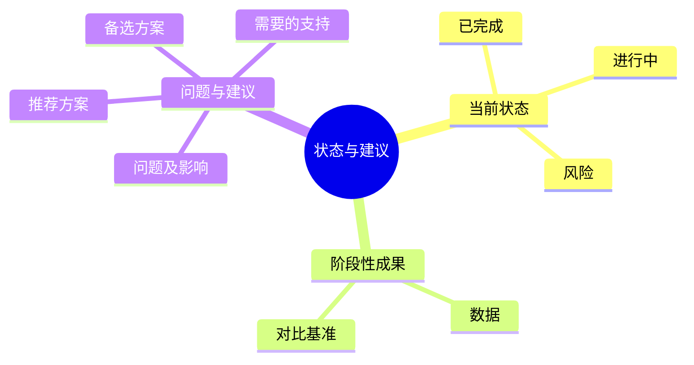
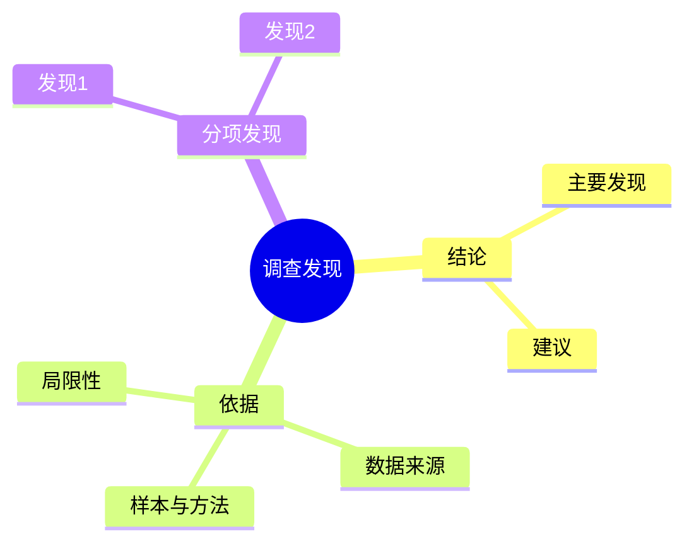
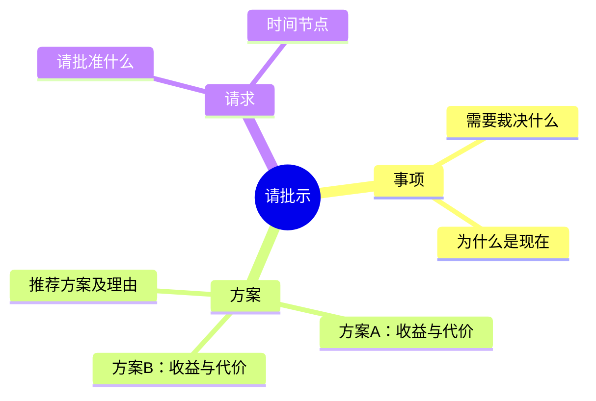
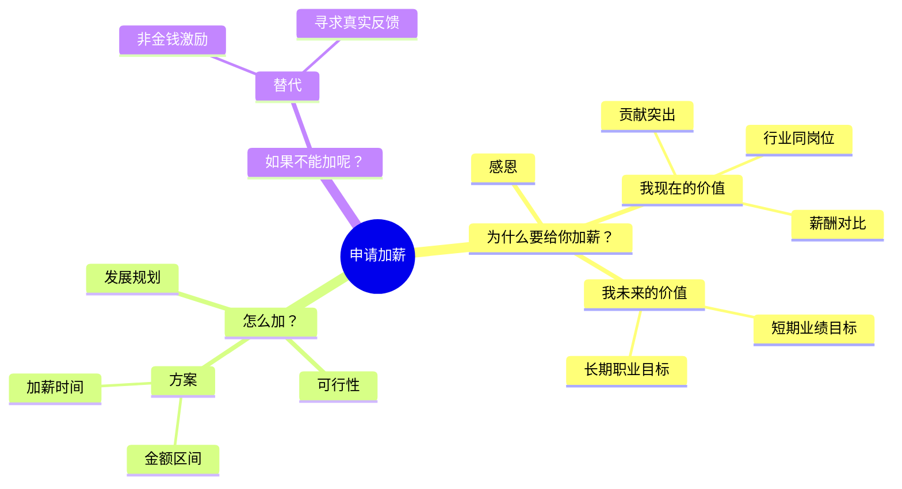
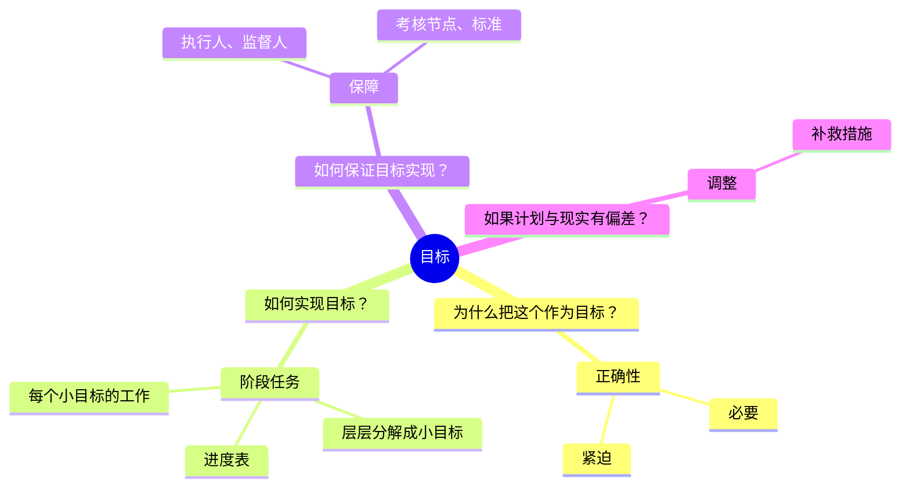
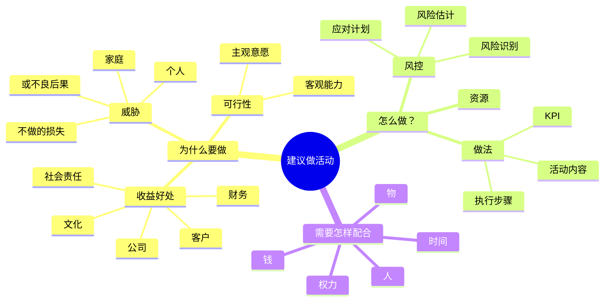
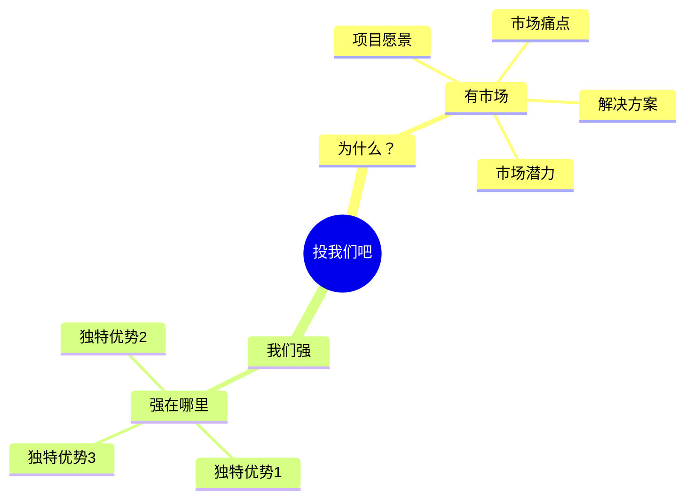
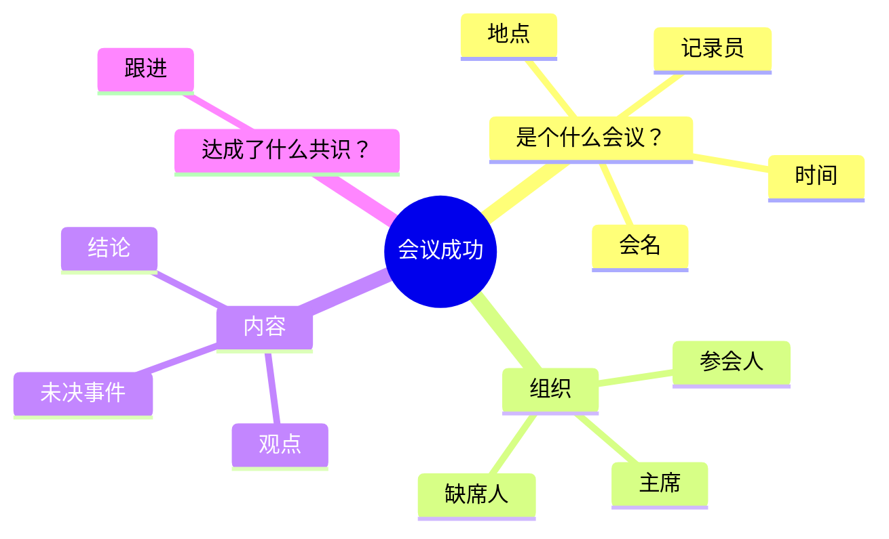

# 职场写作类型卡片

每种职场文案的单一事实来源：提问清单、金字塔结构、写作要点、成品示例都在这里。`SKILL.md` 只放跨类型的规则——**要改某一种文案的问法或结构，改本文件，不要在 `SKILL.md` 里重复**。

**用法**：先用 `SKILL.md` 判断模式和类型，再只读本文件对应的小节。

**候选问题库**：每张卡片的提问清单是候选库，不是一次要问完的清单。实际提问按 `SKILL.md` 的停止规则分轮进行——单轮最多 3 问，最多 2 轮。

| 大类 | 卡片 |
|---|---|
| 总结类 | [年终总结](#年终总结)、[进展汇报](#进展汇报) |
| 调查报告类 | [调查报告](#调查报告) |
| 申请类 | [请示](#请示)、[加薪申请](#加薪申请) |
| 计划类 | [工作计划](#工作计划)、[活动方案](#活动方案)、[项目计划书](#项目计划书) |
| 记录类 | [会议记录](#会议记录) |
| 特殊 | [邮件](#邮件)、[商业计划书](#商业计划书) |
| 附 | [SCQA 序言示例库](#附scqa-序言示例库) |

---

## 年终总结

**本质**：写的是成绩，呈现的是潜力。
**基调（年终总结）**：有深度——不是流水账，是行动指南。
**基调（述职、评审、竞聘）**：依据与证据——每个判断都要能追溯到具体事实。

**提问清单**

- 这份总结用于年度考核，还是评审 / 竞聘场合？（决定用哪条基调）
- 今年完成了哪些关键工作？请用数字说明。
- 有哪些特殊贡献或突破？（提出合理化建议、培育人才、提升自身技能、开拓新领域）
- 遇到了什么挑战？如何克服的？
- 有什么可以沉淀成方法、明年能继承的经验？
- 明年的工作方向或目标是什么？

**金字塔结构**

**写作要点**

- 塔尖不是回顾，而是行动指南
- 将工作成果写出意义：提供一线经验、不同视角
- 在罗列贡献后，找出问题或机遇，以及解决方案
- 每个数字都要有对比基准（去年、目标、同行、其他区域），孤立的数字没有分量

**成品示例**（数据均为虚构，只示范结构与语言，不要当作事实引用）

**《2025 年度总结：把"选品靠感觉"做成一套可复用的方法》**

- **S（情境）**：我的团队负责三个类目，今年承担部门一半的增量目标。
- **C（冲突）**：复盘时发现，上半年两个爆款其实是撞上的：下半年按同样方法推了 5 款新品，只有 1 款起量，起量率 20%。
- **Q（问题）**：明年的增长，能不能不再靠运气？
- **A（回答）**：我把今年的经验沉淀成 12 条选品判断清单，Q4 用它推的 3 款新品有 2 款起量，起量率提到 60%。我建议明年把它变成团队标准流程。

**一、贡献：三个类目完成 GMV 1,860 万，同比增长 41%**（去年 1,320 万，部门平均增速 22%）

- 类目 A：480 万 → 810 万，增量主要来自 3 个新品
- 类目 B：620 万 → 780 万，靠老客复购率从 18% 提到 26%
- 类目 C：220 万 → 270 万，受平台流量政策影响，增速低于部门平均

**二、特殊贡献：把选品经验做成 12 条判断清单**

- Q4 用清单推 3 款新品，2 款起量，起量率从 20% 提到 60%
- 带 2 名新人独立负责类目 C，其中 1 人已能独立完成月度选品评审
- 清单第 7 条"退货率高于类目均值 3 个百分点的爆款要重新核算利润"来自今年的一次失误

**三、教训：夏季品备货失误压了 47 万库存**

- 当时的判断依据是好评率 96%，没有看退货率 21%（类目均值 12%）——按当时的指标看，这个判断是合理的，只是漏了这一层
- 8 月清仓，10 月回笼 38 万，亏损 9 万
- 退货率已写进清单第 7 条，成为新品上架前的必检项

**四、明年方向：把清单变成团队流程**

- 一季度用清单跑满 10 个新品，把起量率稳定在 50% 以上
- 给类目 B、C 也搭退货率看板，让货品风险提前 2 周可见

**结尾**：明年一季度我会把这套清单跑满 10 个新品，每个月把起量率同步给你。如果效果稳定，希望你能帮我把清单推给另外两个小组——他们的类目结构和我们接近，应该能直接复用。

**结构说明**

- 塔尖是"把选品方法沉淀下来并推广"，不是"今年做了多少事"——总结类的价值在潜力，不在账本。
- 第二层按"贡献 → 特殊贡献 → 教训 → 明年方向"分组：前三项回答"今年值不值"，第四项回答"明年怎么走"。
- 冲突类型选"追求理想"：现状（靠运气）与理想（可复制的方法）之间有明确差距，冲突由复盘数据自然带出。

**待补信息清单**

- 【待补：类目 C 增速偏低的具体原因】——正文一里只写了"受平台流量政策影响"，读者会追问是政策变化还是内部投放节奏问题。
- 【待补：推广清单可能遇到的阻力】——结尾建议推广给其他小组，但没说阻力，领导很可能问到。

**优化建议**

- 语言质感：类目 B 的"复购率从 18% 提到 26%"可以再往前挖一步原因，写成"说明老客的购买动作已经从促销驱动转为常规补货"。
- 语言温度：教训部分的"备货失误"保留了"当时的判断是合理的"，避免整段变成自我检讨。

---

## 进展汇报

**本质**：写的是阶段性进展，呈现的是把事情推进到底的能力。
**基调**：不讨教——给方案，不只提问题；让领导做选择题，不做问答题。

**提问清单**

- 项目/工作的当前状态是什么？（已完成、进行中、未开始）
- 取得了哪些阶段性成果？请给具体数据。
- 遇到了什么问题？影响范围有多大？
- 你建议的解决方案是什么？需要什么支持？

**金字塔结构**

**写作要点**

- 塔尖是结论或建议，不是过程
- 问题必须跟方案，且给出推荐项（"我建议 A，备选 B"）
- 数据写清对比基准和截止时间

---

## 调查报告

**本质**：写的是调查结果，呈现的是求实态度。
**基调**：实事求是——用"资料显示""数据显示"，不用"我认为""我觉得"。

**提问清单**

- 这次调查要回答的核心问题是什么？
- 调查的范围和样本是什么？（时间、对象、数量）
- 有哪些关键发现？各自的数据支撑是什么？
- 这些发现指向什么结论或建议？

**金字塔结构**

**写作要点**

- 结论先行，依据在后；不按调查的时间顺序记流水账
- 数据必须可回溯：来源、口径、时间
- 主动写明局限性，比藏起来更能建立信任
- 描述用"资料显示"，把判断权留给读者

---

## 请示

**本质**：内容是提问，呈现的是主动思考方式。
**基调**：有主见——给清晰的量化标准让领导裁决，不要把问题原样上交。

**提问清单**

- 需要领导裁决的事项是什么？
- 有哪些可选方案？各自的收益和代价是什么？
- 你推荐哪个方案？为什么？
- 决策的时间节点是什么？过期会有什么影响？
- 希望领导具体做什么？（批准、签字、协调资源）

**金字塔结构**

**写作要点**

- 塔尖是明确的请求，不是背景铺垫
- 给方案不给问答题，每个方案都写清代价
- 请求要具体到动作和时间（"请批准 4 月 1 日起执行 X"）
- 批复类回复态度明确，不用"似属可行""酌情办理"

---

## 加薪申请

**本质**：内容是提问，呈现的是主动思考方式。
**基调**：有主见、有依据——用数字说清"我值多少"，并给出可执行的方案。

**提问清单**

- 你目前的薪资是多少？期望的薪资区间是多少？
- 你的核心贡献有哪些？请用数字说明，最好带对比基准。
- 与同岗位市场薪资相比如何？数据从哪里来？
- 你未来的短期业绩目标、长期职业目标是什么？
- 如果这次不能加，你希望得到什么替代方案？

**金字塔结构**

**写作要点**

- 感恩不单独成段：放在正文第一段的第一句，然后立刻进入价值
- 用数字证明贡献（信息化语言），并写清数据来源
- 提出合理的加薪方案（金额区间、时间节点）
- 准备替代方案（非金钱激励、明确下次评估标准）；"不能加怎么办"这一节即使信息不全也要保留，缺的用占位——省略会被读成没有退路

**成品示例**（数据均为虚构，只示范结构与语言）

**《加薪申请：我希望能承担更完整的业务责任，并把薪资调整到匹配的水平》**

- **A（回答）**：我申请把月薪从 18K 调整到 22K，从 4 月 1 日起生效。
- **S（情境）**：我入职 2 年，负责的华东区 3 个客户从 0 起步，去年签约 620 万，占部门新签的 28%。
- **C（冲突）**：今年我的职责已经扩到方案设计和交付管理，相当于团队里 P6 的范围，但薪资仍在 P5 区间；同岗位市场区间是 20-24K。
- 用 ASC 排序：领导时间紧、对这类话题关注度高，先给结论，再补情境和冲突。

**一、我现在的价值：两个可核对的数字**

- 签约：华东区 3 个客户，去年签约 620 万（部门新签 2,210 万，占 28%）
- 交付：今年独立交付 5 个项目，其中 2 个提前 2 周完成，客户续约率 100%
- 带人：协助培养 1 名新同事，已能独立负责 1 个中型客户

**二、我未来的价值：从"做单子"到"做能力"**

- 短期（今年内）：把华东区的交付模板整理成可复用的方法，让新人上手周期从 3 个月缩到 6 周
- 长期：独立带一条业务线，承担从售前到交付的完整责任

**三、我建议的方案**

- 金额：月薪 18K → 22K（涨幅 22%），处在市场区间 20-24K 的中位
- 时间：4 月 1 日起生效，与季度调薪窗口一致
- 依据：市场数据来自【待补：数据来源】

**四、如果这次不能调整**

- 希望能明确达到什么标准、什么时间点可以再谈（例如 Q3 复盘时）
- 也愿意讨论非金钱方案，比如带业务线的正式授权或培训机会

**结尾**：无论结论如何，我都会在 Q2 内把华东区的交付模板整理完并同步给团队。如果您希望先看模板再谈调整，我可以在 3 月底前把第一版发您。

**结构说明**

- 塔尖是"申请把薪资调整到 22K"，不是"我今年很努力"——申请类的价值在于把判断标准摆清楚。
- 第二层按"现在值多少 → 未来值多少 → 怎么加 → 不能加怎么办"分组：前两项给依据，后两项给可执行的方案和退路。
- 用 ASC 排序，因为这是高关注度、领导时间紧的话题，先给要裁决的那一句话。

**待补信息清单**

- 【待补：市场薪资数据来源】——正文三引用了 20-24K 的区间，读者一定会问依据（招聘平台、同行了解还是内部薪酬带宽）。来源说不清，整个方案的支点就没了。

**优化建议**

- 语言质感：第二部分"让新人上手周期从 3 个月缩到 6 周"可以补一句怎么做到（"把交付动作拆成 12 个可检查的节点"），否则听起来像口号。
- 语言温度：结尾先给承诺再给请求，避免"如果不加薪我就……"这类隐含对抗的写法。

---

## 工作计划

**本质**：写的是阶段任务，呈现的是责任感。
**基调**：可交付——写结果，不只写行为。

**提问清单**

- 目标是什么？为什么选这个目标（必要性、紧迫性）？
- 如何实现？阶段任务如何层层分解成小目标？进度表怎么排？
- 如何保证目标实现？执行人、监督人、考核节点和标准是什么？
- 如果计划与现实出现偏差，如何调整？

**金字塔结构**

**写作要点**

- 明确目标的正确性和紧迫性
- 将大目标层层分解为小目标
- 设定保障措施和考核标准
- 预留调整空间，写清偏差出现时的补救办法

---

## 活动方案

**本质**：写的是活动安排，呈现的是收益判断和责任边界。
**基调**：有依据、算得清——先说为什么值得做，再说怎么做。

**提问清单**

- 活动目的是什么？
- 预期收益是什么？（公司、客户、财务、文化、社会责任等多维度）
- 不做会有什么损失？
- 具体怎么做？（活动内容、执行步骤、KPI）
- 需要什么资源？（人、钱、物、时间、权力）

**金字塔结构**

**写作要点**

- 阐述为什么要做（收益、威胁、可行性）
- 说明怎么做（做法、风控、KPI）
- 明确需要怎样配合（人、钱、物、时间、权力），把责任边界写清楚

---

## 项目计划书

**本质**：写的是这件事值得投，呈现的是对市场和自身的判断力。
**基调**：可交付、有证据——判断要落到数据，优势要落到可验证的事实。

**提问清单**

- 项目愿景是什么？（一句话高度精炼）
- 市场痛点是什么？
- 你们的解决方案是什么？
- 市场潜力如何？（规模、用户画像、竞品分析）
- 你们的独特优势是什么？（行业经验、核心技术、团队）
- 发展规划和盈利模式是什么？
- 需要多少融资或资源？

**金字塔结构**

**写作要点**

- 按投资人逻辑组织内容：先讲行业和市场，再讲自己
- 融资额度放最后——先讲价值，再讲价格
- 详细的内容排序见下方"商业计划书"卡片，两张卡片共用同一套排序

---

## 会议记录

**本质**：写的是会议经过，呈现的是可执行、可追溯。
**基调**：客观、可跟进——只记结论和未决事项，不做美化。

**提问清单**

- 会议名称、时间、地点、记录人分别是什么？
- 参会人、缺席人、主持人是哪些？
- 达成了哪些结论？有哪些不同观点需要保留？
- 哪些事项未决？谁在什么时间前跟进什么？

**金字塔结构**

**写作要点**

- 清晰记录会议基本信息
- 明确达成的共识和结论
- 记录未决事件和后续跟进事项
- 跟进事项必须落到"谁、做什么、什么时候前"，否则会议记录等于没写

---

## 邮件

**本质**：日常沟通，用单向的文字建立双向沟通的感觉。
**基调**：有温度、有重点——前三句有情，之后立刻进入主题。

**提问清单**（读者和目的按 `SKILL.md` 的通用四题问，这里只列邮件特有的追加项）

- 问"读者是谁"时一并问清关系：同级、上级还是客户？决定语气和用词分寸。
- 这是第几轮往来？上一轮对方承诺或要求了什么？
- 有没有硬时间节点？有没有已经到期未交付的事项？

**写作套路**

**标题：呼唤你、愉悦你**

- 不写《12月3日的培训课程》，写《12月3日——学习成为有效沟通者》
- 不写《5月12日会议纪要》，写《5月12日会后行动方案，请批示》
- 多轮邮件：《年度明星员工：Re:部门会议的筹备》
- 回复对方来信时保留 `Re: 原主题`；原主题过于笼统（如"关于Q2预算"）才补一个说明性后缀，例如 `Re: 关于Q2预算——说明周五前呈报`

**开头：有温度、有重点**

前三句话写出个性和感性智慧，然后马上进入主题。

- "嘿，刚刚的发言很精彩！"（电话会议后）
- "夏天的贵州很凉爽吧。"（对方度假回来）
- "上周的年会受益匪浅，终于和你真人见到面啦。"（参加完对方年会后）

**正文：三个凡是**

1. 凡是能分段就分
2. 凡是能做小标题的就做（最好用动宾结构）
3. 凡是能列清单图表的就列

**诉求：立场清晰、语气尊重**

- 把句子拉长（同级沟通时）
- 对上级不拉长句子：改用"问句 + 给两个可选时间 + 说明自己能先做的一步"
- 用问句把需求写出去

不写："我明天之前需要你的回复"
写："请问明天之前您方便回复吗？如果时间紧张，请告知我，我可以协助处理。"

**结尾：积极开放**

- 不写："如果您有任何问题，请随时和我联系"
- 写："我会每周和您更新这个项目的进程"
- 写："我期待能和您在电话里进一步讨论"

**成品示例**（场景：催一个已延期两次的数据接口；数据均为虚构）

**标题**：商品数据接口——这周能把上线时间定下来吗？

**开头**：上周评审会上你把字段口径讲得很清楚，我们这边照着改一次就通了，省了不少来回。

**（一）现在卡在哪里**

- 我们侧的前端字段已按新口径改完，18 日自测通过
- 只等接口返回的 `customs_code` 字段，联调才能往下走

**（二）为什么需要这周确定**

- 28 日要给客户演示，联调至少需要 3 个工作日
- 如果这周定不下来，演示要换一版数据，客户那边需要提前沟通

**诉求**：请问这周能给出接口的确定上线时间吗？如果排期上有困难，也请告诉我卡在哪一步，我们这边的字段映射可以先做，减少你们的工作量。

**结尾**：我每周三会把联调进度同步给你，有变化我提前说。谢谢！

**结构说明**

- 标题不写"数据接口延期跟进"，而写成一个具体问题，对方一眼知道要回什么。
- 正文按"卡在哪里 → 为什么急 → 我需要什么"分段，每段能列清单就列清单。
- 诉求用问句，并主动让出一步（"我可以先做字段映射"），把催办变成协作。

**待补信息清单**

- 无

**优化建议**

- 语言温度：结尾的"谢谢"后面可以补一句具体的期待（"定下来我这边马上就开工"），比单纯道谢更有推进力。

---

## 商业计划书

**本质**：写的是这件事值得投，呈现的是完整的商业逻辑。
**基调**：可交付、有证据——每一层判断都要有数据或事实承接。

**提问清单**

- 项目愿景是什么？（一句话高度精炼）
- 市场痛点是什么？
- 你们的解决方案是什么？
- 市场潜力如何？（市场规模、用户画像、竞品分析）
- 你们的独特优势是什么？（行业经验、核心技术、团队）
- 发展规划和盈利模式是什么？
- 需要多少融资或资源？

**内容排序**（按"要话先说"的读者逻辑）

1. **项目愿景**：你要做一件什么样的大事（高度精炼的一句话）
2. **市场痛点**：这件事为什么值得做
3. **解决方案**：这把钥匙能开得了这把锁
4. **市场潜力**：市场规模、用户画像、竞品分析
5. **独特优势**：行业经验、核心技术、牛人团队
6. **发展规划**：盈利模式和发展路径
7. **财务分析**：需要多少钱

**写作要点**

- 首次接触中，退出机制、利润分红等内容不重要，可以不写
- 先讲价值，再讲价格（融资额度放在最后）
- 结构同"项目计划书"卡片，两张卡片共用同一套排序

---

## 附：SCQA 序言示例库

序言写不好，塔尖再对也没人读。以下是三种排序的范例，写法分别为 SCQA、ASC、CSQA。

### 示例1：团队沟通优化（SCQA）

- **S（情境）**：增强团队凝聚力至关重要，紧密团结的队伍和雇员的业绩表现密不可分。
- **C（冲突）**：然而，团队效能的关键不在于每次沟通后达成的结果，而在于沟通方式。沟通模式才是预测团队能否成功最重要的指标。
- **A（回答）**：我建议在本公司设置周五午餐会，来建立团队成员间的信任，提高他们加入团队谈话的参与度。

### 示例2：跨文化沟通培训（ASC）

- **A（答案）**：我建议在团队赴日本谈判以前，进行一次跨文化沟通的内训。
- **S（情境）**：这次跨国谈判涉及到中方、日方和美方，因为文化不同，不存在单一的国家攻略。
- **C（冲突）**：而我们团队的同事，对于怎样恰当表达异议，怎样收放自如，怎样和其他文化人群建立信任，都不曾了解过。

### 示例3：人才甄选标准（CSQA）

- **C（冲突）**：去年我公司评出的十佳员工，出乎意料的都是经验小于五年的行业新手。
- **S（情境）**：当今市场迅速变化，我们面临的挑战也不断迭代，这意味着人力资源部在挑选人才的标准也需要与时俱进。
- **Q（问题）**：我们怎样去甄选高潜力复合型人才呢？
- **A（回答）**：我建议从三方面树立甄选标准：正确的动机、好奇心、洞见。
